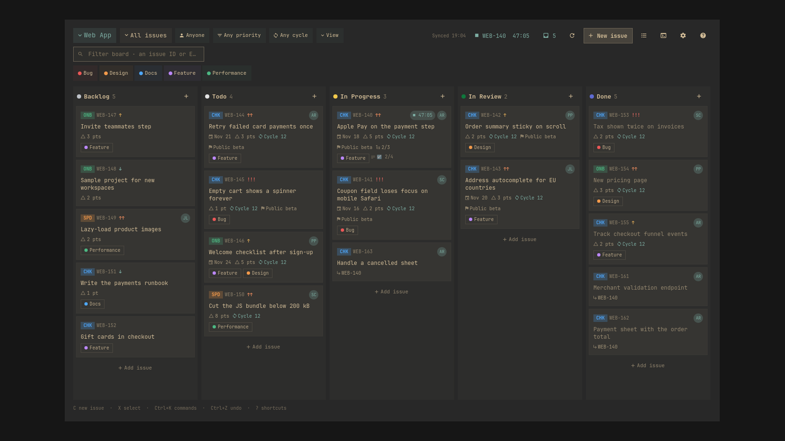
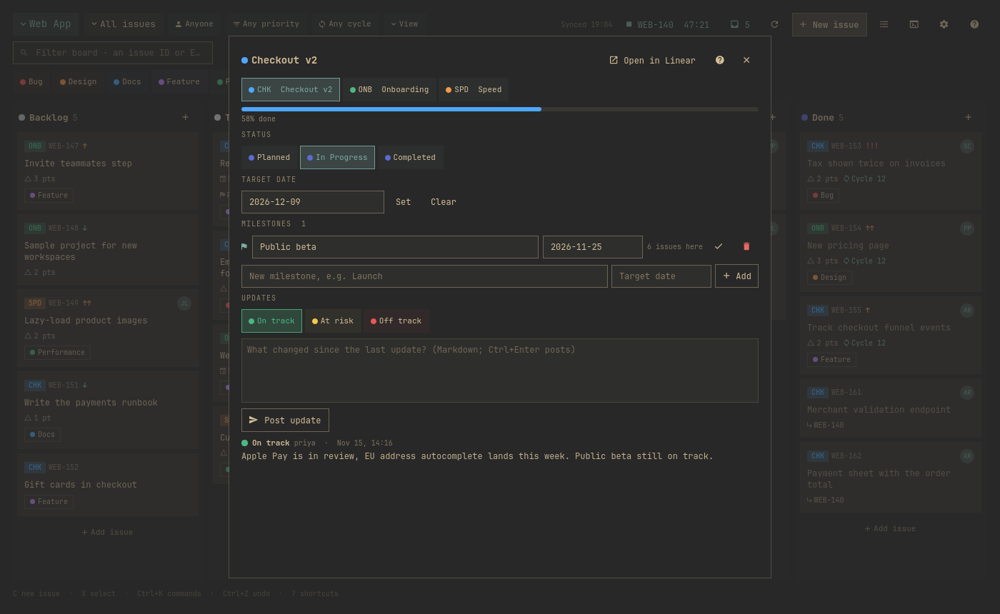

# Linear Board

A Kanban board for [Linear](https://linear.app) in the Omarchy shell. Your team's issues sit in columns by status, and you
work with them the way you do in Linear, with the same shortcuts. It also adds what Linear doesn't have: time tracking,
recurring issues and an unread count in the bar.

Every change goes to Linear right away. If you're offline, changes wait and are sent when you're back.



## Install

You need Omarchy 4 and a Linear account.

```bash
omarchy plugin add https://github.com/MaNi4/omarchy-linear-board.git --enable
```

## Getting started

1. Press `Super + Shift + K` to open the board.
2. Paste a personal API key. You create one in Linear under Settings → Security & access. You can also set the
   `LINEAR_API_KEY` environment variable instead.

Then:

- Drag a card to another column, or move it with `Shift` + arrow keys.
- Click a card to open it. Changes are saved as you make them, and `Ctrl+Z` undoes the last one.
- Press `?` to see the shortcuts of the window you're in, or `Ctrl+K` to find any action by name.
- Linear's shortcuts work too: `C` new issue, `S` status, `P` priority, `A` assignee, `G` then `I` inbox, and so on.

## Features

- **Board and list view.** Columns are your team's statuses. Sort, group and filter cards, or select several and change
  them at once.
- **Issue editor.** All issue properties, sub-issues, relations, links, comments with mentions and reactions, history,
  Markdown with checklists, and images or files you paste or drop in.
- **Search** across all your teams, open an issue from a pasted link or ID, and see your issues from every team.
- **Inbox** with your Linear notifications, desktop notifications for new ones, and the unread count in the bar.
- **Cycles, project overview** (progress, milestones, updates), **triage**, **archive and trash**.
- **Time tracking.** Start a timer on any issue or add time by hand, see a report, export it to CSV, and optionally
  post logged time to the issue as a comment.
- **Recurring issues** every day, weekday, week or month.
- **Undo** for the last 30 changes, and an **offline queue** that sends your changes once Linear is reachable.

| Issue editor | Inbox | Project overview |
|---|---|---|
|  |  |  |

The screenshots use made-up data. [FEATURES.md](FEATURES.md) describes every feature in detail.

## Global shortcuts

| Shortcut | Action |
| --- | --- |
| `Super + Shift + K` | Show or hide the board |
| `Super + Alt + Shift + K` | New issue |

You can change them in Settings → Keys. The board never takes a shortcut that's already in use. If one is taken, a
notification tells you, and clicking it opens Settings → Keys. The shortcuts are saved in
`~/.config/omarchy/extensions/linear-board.json`.

To bind the board yourself, use this command:

```bash
omarchy-shell shell summon mani4.linear-board '{"toggle":true}'
```

## What the board adds to Linear

Your issues, comments, projects and cycles live in Linear, and the board only shows and edits them. A few features
don't exist in Linear, so the board adds them and keeps their data on your computer:

| Feature | What it does | Where the data is | Visible in Linear? |
| --- | --- | --- | --- |
| Time tracking | A timer on any issue, time added by hand, a report and CSV export | `time.json` on your computer | Only if you keep posting time as comments (on by default) |
| Recurring issues | A new copy of an issue every day, weekday, week or month | `config.json` | The copies are normal Linear issues. The schedule isn't. |
| Project codes | Short codes like `WEB` shown on cards | `config.json` | No |
| Board settings | Hidden columns, sorting, grouping, layout, how long done issues stay | `config.json` | No |
| Bar and notifications | Unread count in the bar and desktop notifications for new ones | Nothing to keep | They are your Linear notifications |
| Offline queue | Changes made without a connection, sent later | `outbox.json` in the cache | Yes, once they are sent |

Recurring issues are created by the board itself, so a copy is only created while the Omarchy shell is running. If
the computer was off on that day, the board creates the latest missed copy when it starts.

### Backup and moving to another computer

Settings → Data → **Export everything** saves one file, `linear-board-export-<date>.json`, to `~/Downloads`. It
contains your time entries (and a running timer), recurring issues, project codes and board settings. It doesn't
contain your API key, your global shortcuts, or the team and filters the board is showing.

On another computer, paste the file's path into **Import** in the same place. Import only adds what's missing, such as
time entries, recurring issues, project codes and hidden columns. It never replaces or deletes anything, so you can
import the same file twice without duplicates.

For timesheets, the time report (`W`) exports the selected day, week or month as a CSV file to `~/Downloads`.

### Using it on several computers

To keep the same data on several computers all the time, set a shared folder in Settings → Data, for example a folder
you sync with Syncthing. The board then keeps its time and settings files there:

- A computer that points to a folder that already has these files uses them. Nothing there gets overwritten.
- If the files are missing (the sync isn't finished yet, or a drive isn't mounted), the board waits for them and keeps
  changes on this computer in the meantime.
- If both computers changed something before they synced, Syncthing keeps a second copy with `sync-conflict` in its
  name. The board merges that copy within 30 seconds, so no time entries or recurring issues are lost. An entry you
  deleted on one computer can come back from the other computer's copy.
- A recurring issue is created only once, even when two computers create it at the same moment.

Each computer keeps its own selected team, project and filters, its shortcuts and its API key.

### If you uninstall

Removing the plugin doesn't delete anything in Linear or on your computer. Your time, recurring issues and settings
stay in the files listed under [Your files](#your-files). Export them first if you want a single file to keep.
Recurring issues stop being created once the board is gone.

## Your files

| File | What's in it |
| --- | --- |
| `~/.config/omarchy-linear-board/config.json` | Selected team and project, filters, board settings, project codes, recurring issues |
| `~/.config/omarchy-linear-board/api-key` | Your Linear API key, readable only by you |
| `~/.config/omarchy-linear-board/time-location` | The shared folder, if you set one |
| `~/.local/share/omarchy-linear-board/time.json` | Tracked time, when there's no shared folder |
| `<shared folder>/linear-time.json`, `linear-board.json` | Time and settings, when there is a shared folder |
| `~/.config/omarchy/extensions/linear-board.json` | Global shortcuts |
| `~/.cache/omarchy-linear-board/` | The last loaded board (so it opens instantly), changes waiting to be sent, downloaded images |

## Troubleshooting

- **The bar icon is dimmed.** The unread count is more than 5 minutes old, usually because Linear can't be reached.
  The tooltip says since when and why.
- **"Offline · N waiting" in the header.** Your changes are saved and will be sent once Linear responds again.
- **After waking the computer from sleep,** the first request can take a few seconds. The board notices stale
  connections and opens new ones by itself.
- **"Linear's rate limit was reached".** Linear allows only so many requests per hour. The board waits until the
  limit resets and sends your changes then.
- **"Linear rejected the API key".** The key was revoked or has expired. Create a new one in Linear and paste it in.

## Uninstall

```bash
omarchy plugin remove mani4.linear-board
```

The global shortcuts are removed. Your settings, time and cache stay in the folders listed under
[Your files](#your-files). Delete them if you don't need them.

## Requirements

- Omarchy 4. Everything else the board uses (`curl`, `wl-clipboard`, Python with GObject) comes with it.
- A Linear account and a personal API key. The free plan works, and the board shows how many of its 250 issues you use.

## Development

[DEVELOPMENT.md](DEVELOPMENT.md) explains how the code is organized and how to run the tests.

## License

MIT
