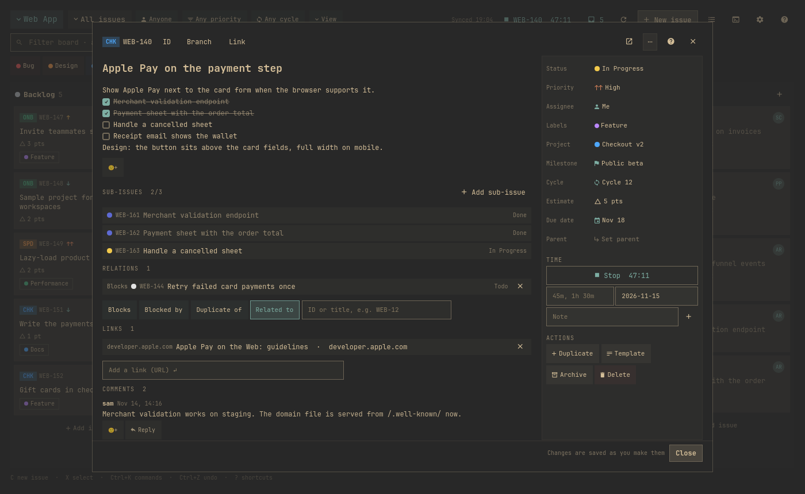
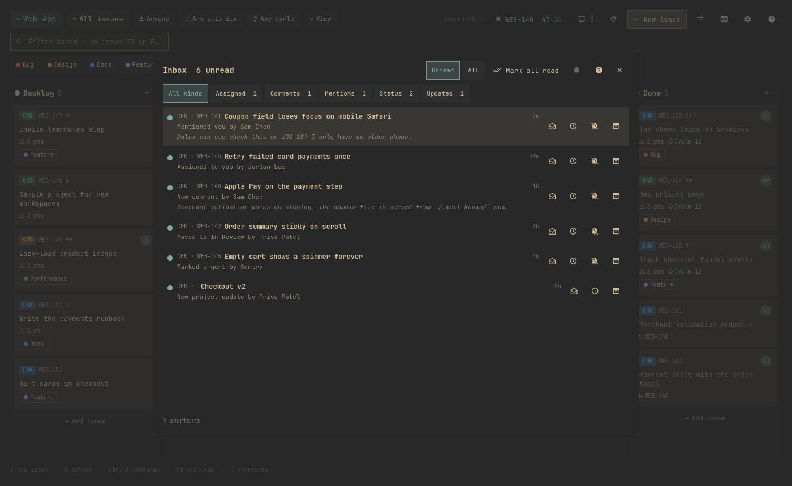

# Linear Board

A kanban window for [Linear](https://linear.app) in the Omarchy shell: your team's issues in columns by
workflow state, edited like in Linear and with Linear's keys, plus what Linear does not have: time tracking,
recurring issues and an inbox count in the bar. Changes go to Linear at once, and wait when you are offline.


## Install

Requires Omarchy 4 and a Linear account.

```bash
omarchy plugin add https://github.com/MaNi4/omarchy-linear-board.git --enable
```

## Remove

```bash
omarchy plugin remove mani4.linear-board
```

The global keys are released. Your settings, time entries and cache stay in the folders listed under
[Files](#files); delete them by hand if you want them gone.

## First steps

`Super + Shift + K` toggles the board, `Super + Shift + Alt + K` opens it straight on a new issue. The first
time, paste a personal API key from Linear → Settings → Security & access (or set `LINEAR_API_KEY`).

- **Drag** a card to another column, or move it with Shift + arrows. **Click** it to edit it: every change is
  saved to Linear as you make it, and a toast undoes it (`Ctrl+Z`).
- **`?`** (or `F1`, also while typing) shows the keys of the window you are in, and **`Ctrl+K`** finds any action
  by name. Hovering a button shows what it does and its key.
- **Linear's keys** work: C new issue, S status, P priority, A assignee, X select, G then I inbox, and so on.

## What it does

- **Board and list**: columns are the team's workflow states; sort, group, filter by label, assignee, priority
  and cycle; pick several cards and change them at once.
- **Issue editor**: all the properties, sub-issues, relations, links, comments with mentions and
  reactions, history, Markdown with checklists, images and files (paste or drop).
- **Search** every issue of every team, open a pasted Linear link or ID, **My issues** across teams.
- **Inbox**: Linear's notifications, grouped like in Linear, with desktop notifications and an unread count in the bar.
- **Cycles**, **project overview** (progress, milestones, updates), **triage**, **archive and trash**.
- **Time tracking**: a timer on any issue, time added by hand, a report with CSV export; logged time can be posted
  as a comment.
- **Recurring issues**: every day, weekday, week or month; each copy is a new issue.
- **Undo** for the last 30 changes, and an **offline** queue that sends changes when Linear is back.

| Issue editor | Inbox | Project overview |
|---|---|---|
|  |  |  |

The pictures show made-up data (`node tests/e2e/screenshots.js` makes them again).

[FEATURES.md](FEATURES.md) describes every feature in detail.

## What lives outside Linear

Linear has no place for these, so the board keeps them itself:

| What | Where (this computer only) | Shared folder |
| --- | --- | --- |
| Tracked time and the running timer | `~/.local/share/omarchy-linear-board/time.json` | `linear-time.json` |
| Recurring issues | `~/.config/omarchy-linear-board/config.json` | `linear-board.json` |
| Project codes | `config.json` | `linear-board.json` |
| Hidden columns, sort, grouping, layout, completed issues shown | `config.json` | `linear-board.json` |
| Time as Linear comments on/off, desktop notifications on/off | `config.json` | `linear-board.json` |
| Team, project and assignee filter the board is on | `config.json` | not shared |
| Global keys | `~/.config/omarchy/extensions/linear-board.json` | not shared (another computer may have them taken) |
| API key | `~/.config/omarchy-linear-board/api-key` | never shared or exported |

**Shared folder** (Settings → Data): type a folder, e.g. a Syncthing one such as `~/Sync/linear`, and press Apply. The time and settings files are kept there. A computer pointed at a folder that already has them uses those, and anything missing is copied from that computer. A file that should be there but is not (sync not finished, disk not mounted) is waited for and never replaced; until it shows up, changes stay on that computer. `config.json` keeps a copy of the shared settings, so the board works the same when the folder is gone. An empty field keeps everything on this computer again.

If the same thing is changed on two computers before they sync, the sync tool keeps one version (Syncthing leaves the other beside it as a `sync-conflict` file). Recurring issues are still made only once a day, since the board first asks Linear whether the copy exists.

**Export and import** (Settings → Data): "Export everything" saves one JSON file to `~/Downloads` with all of the above except the API key, the global keys and where the board is. Import only adds what is missing on this computer (time entries, recurring issues, project codes, hidden columns) and never replaces anything. Older time-only exports import too.

## Global keys

| Key | Action |
| --- | --- |
| Super + Shift + K | Show or hide the board |
| Super + Alt + Shift + K | New issue |

Change them in Settings → Keys: pick a free key from the list or type your own (e.g. `super + alt + l`), or choose "No key". They are kept in `~/.config/omarchy/extensions/linear-board.json`:

```json
{
  "hotkey": "SUPER + SHIFT + K",
  "newIssueHotkey": "SUPER + ALT + SHIFT + K"
}
```

The plugin never overrides a key that is already in use: one notification names the taken keys, and clicking it opens Settings → Keys, where taken keys show what holds them. Keys are bound in the running Hyprland session (`hyprctl eval`), bound again after Hyprland reloads its config, and released when the plugin is disabled or removed.

Without a key, the same as a command (e.g. for your own binding):

    omarchy-shell shell summon mani4.linear-board '{"toggle":true}'

## Files

- `~/.config/omarchy-linear-board/config.json`: selected team, project, filters, hidden columns, layout, project codes and recurring issues
- `~/.config/omarchy-linear-board/api-key`: the Linear API key (the folder is readable only by you)
- `~/.config/omarchy-linear-board/time-location`: the shared folder, if one is set
- `~/.local/share/omarchy-linear-board/time.json`: tracked time, when no shared folder is set
- `<shared folder>/linear-time.json` and `<shared folder>/linear-board.json`: time and settings, when one is set
- `~/.config/omarchy/extensions/linear-board.json`: the global keys
- `~/.cache/omarchy-linear-board/cache.json`: the last board, so it shows instantly while it refreshes
- `~/.cache/omarchy-linear-board/outbox.json`: changes made offline, waiting to be sent
- `$XDG_RUNTIME_DIR/omarchy-linear-board/inbox.json`: unread count and running timer for the bar widget

## Requirements

- Omarchy 4 (the shell, Hyprland, `curl`, `wl-clipboard`, Python with GObject: all come with Omarchy).
- A Linear account and a personal API key. The free plan works (the board shows how many of its 250 issues are used).

## How it works

- `Board.qml`: the overlay itself: state, Linear requests, config and cache, lookups, cursor and the window.
- `ui/`: what is drawn: the board and list (`BoardView` with `BoardHeader`, `BoardColumn`, `IssueCard`, `ListGroup`), the issue editor (`IssueEditor` with `EditorHeader`, `EditorLinks`, `EditorActivity`, `EditorSidebar`), settings, time report, inbox, search and lists, command palette, project overview, shortcut help, toast, confirm, plus small parts (`Label`, `Chip`, `MarkdownView`…).
- `logic/`: what happens: `EditorState` (the issue being edited, id `ed`), `Notices` (toasts and desktop notifications, id `notices`), `Sync` (offline outbox, loading), `TimeTracker` (also the time report's state), `SharedFolder` (the shared folder, export and import), `InboxCtl` (also the inbox state), `Lists` (also the search state), `Undoer`, `IssueOps`, `EditorOps`, `Uploads`, `Workspace`, `Commands`, `ProjectOps`, `Pickers` (also the open picker and the confirmation box), `Bulk` (also drag and drop), `Keyboard`. `Board.qml` keeps what the whole board shares: the connection, the team's data, the filters, the cursor and the theme.
- `bin/linear-notify`: sends desktop notifications over D-Bus. It reads them on stdin, so issue titles and inbox text never show up in process listings (they would with `notify-send` arguments). A click runs its action through Omarchy's notifications (`omarchy-exec-argv`), also later from the notification history.
- `Linear.js`: only what the board says to Linear's API and how it reads the answers (queries, mutations, filters, inputs, Linear's fixed values, errors).
- What the board does on top of Linear, as pure helpers: `Issues.js` (columns, filters, search, sorting, moving cards, project codes, copying), `Edit.js` (what an edit sends and what undoes it), `Recur.js` (recurring issues), `Inbox.js` (inbox filter, paging, the bar's view of the inbox state), `Markdown.js` (checklists, images, mentions), `Dates.js`.
- `Time.js` (time tracker data), `Shared.js` (shared settings, export and import), `Help.js` (shortcut help), `Hotkey.js` and `Service.qml` (the global keys), `BarWidget.qml` (bar badge and timer).

When things go wrong:

- The inbox is checked every minute. A check that never comes back is given up after 5 minutes, and an answer that cannot be read does not stop the next checks. When the bar's count is more than 5 minutes old, its icon dims and the tooltip says since when and why.
- After a plugin reload an old board can still be running; the bar follows the one that started last.
- The inbox uses fields Linear marks internal (unread count, grouping, titles). Should Linear turn them off, the inbox switches to its public fields and makes them up the same way (newest 200 notifications).
- Linear's rate limit: no request goes out until Linear's reset time (at most an hour), and changes wait in the outbox meanwhile.
- A list cut off by the page limit says so instead of looking complete.

Every file in `ui/` and `logic/` is created inside `Board.qml` (the editor's parts inside `IssueEditor.qml`) and reaches the board through the id `root` and the other parts through their ids (`editor`, `issueOps`…).

## Tests

    npm install    # once: the graphql package, for the API check
    npm test

- `tests/helpers.test.js`, `time.test.js`, `shared.test.js`, `hotkey.test.js`: the pure helpers.
- `tests/refs.test.js`: every `Linear.x`, `Issues.x`… a QML or JS file uses exists in that file and is imported; no unused imports.
- `tests/members.test.js`: every `root.x`, `pickers.x`, `ed.x`… one part of the board uses from another exists there.
- `tests/api.test.js`: every query and mutation, the input fields the board sends, and the filters and inputs it builds (the issue editor's saves and their undo included), checked against Linear's current schema (downloaded from linear/linear). It fails when something is gone or deprecated. `LINEAR_SCHEMA=live LINEAR_API_KEY=… node tests/api.test.js` reads the schema from the API itself.

End to end, on an Omarchy machine:

    npm run test:e2e        # or: node tests/e2e/run.js <name filter>

`tests/e2e/run.js` starts `tests/fake-linear.js`, a stand-in for Linear's API that answers from made-up data (a team, issues, an inbox) against Linear's schema, and runs the board with its bar widget in a separate, offscreen Quickshell with its files in a temporary directory. Nothing shows on the desktop and nothing reaches Linear or your own files; desktop notifications, `hyprctl`, `wl-copy` and `xdg-open` are stubs. It covers loading, edits, the offline outbox, rate limits, timeouts, broken answers, a wrong or revoked key, the inbox and its fallback, desktop notifications, paging and the bar widget. The fake server also works by hand: `node tests/fake-linear.js`, then start a shell with `LINEAR_BOARD_ENDPOINT=http://127.0.0.1:47123/graphql LINEAR_API_KEY=lin_api_fake` (only an address on this machine is accepted there).

`tests/e2e/shared.js` runs two such boards as two computers sharing a folder (Settings → Data): time and settings reach the other one, Syncthing's `.sync-conflict` copies are merged (time entries and recurring rules from both are kept), and a recurring issue due on both at the same moment is made once.

Against the real API, in a Linear project kept for testing (everything it makes is named `[bt] …` and deleted at the end; the inbox is only read):

    LINEAR_TEST_PROJECT=<project id> node tests/e2e/live.js

The board's requests then go through a local proxy that can lose, delay or refuse them, so the outbox, rate limit and lost-answer cases also run against Linear's real answers.

GitHub Actions runs `npm test` on every push and every morning, so a change in Linear's API fails a run (GitHub sends an email). With a `LINEAR_API_KEY` repository secret it also checks the live API's schema.

## License

MIT
